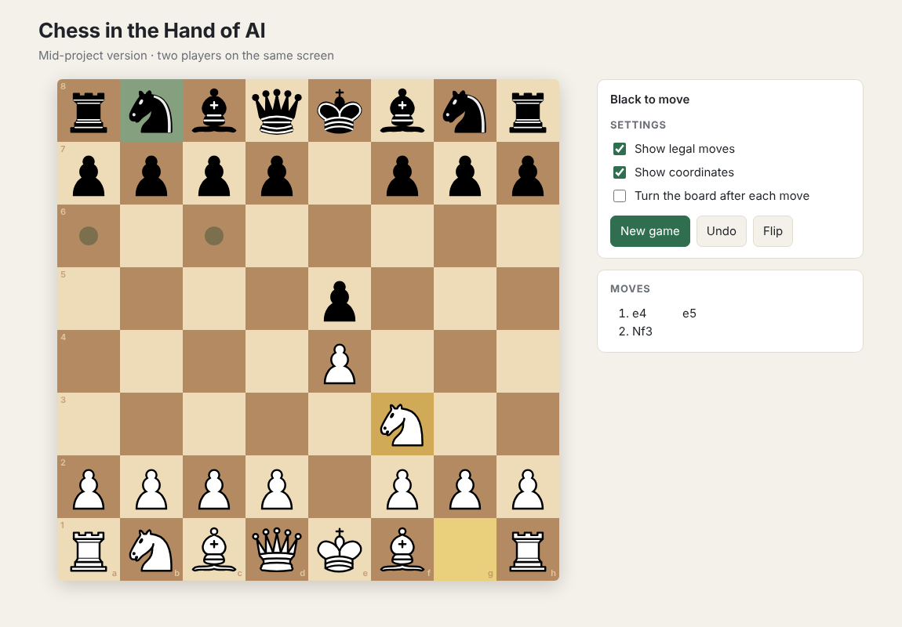

# Chess in the Hand of AI

A chess app where you will play against the computer at **four AI levels** (Easy, Medium, Hard, Master).

*Introduction to AI (IT3160E) · HUST · Group [__]*



> **Mid-project status.** This version contains the playable chess board only.
> Two players share the same screen (White and Black take turns). The AI levels are the next step.

---

## Quick start

Requires **Python 3.10+**.

```bash
git clone https://github.com/<your-account>/chess-in-the-hand-of-ai.git
cd chess-in-the-hand-of-ai
python -m venv .venv
source .venv/bin/activate          # Windows: .venv\Scripts\activate
pip install -r requirements.txt
python -m app.server
# then open http://127.0.0.1:5000
```

Click a piece, then a target square. White and Black play in turn.

**Settings**
- *Show legal moves* – dots on the squares the selected piece can reach
- *Show coordinates* – letters and numbers on the board edge
- *Turn the board after each move* – the side to move is always at the bottom
- *New game*, *Undo* (one move back), *Flip* (turn the board by hand)

**Tests**

```bash
python -m pytest
```

---

## What is done

| Part | Status |
|---|---|
| Board display (pieces, last move, check highlight) | Done |
| Legal moves for both sides, incl. castling, en passant, promotion | Done |
| End of game: checkmate, stalemate, draws (repetition, 50 moves, material) | Done |
| Move list in chess notation | Done |
| AI levels 1–4 (search + evaluation) | Next step |
| Benchmarks between levels | Next step |

The rules are checked on the server with the [python-chess](https://python-chess.readthedocs.io) library,
so the page cannot play an illegal move.

## Project structure

```
app/
  server.py          Flask server: checks moves, returns the position
  static/index.html  Page layout
  static/app.js      Board drawing and clicks
  static/style.css   Look of the page
tests/
  test_server.py     Rule checks (legal moves, illegal move refused, checkmate)
```

## Next steps

1. Add the search algorithm (minimax, then alpha-beta) and a position evaluation.
2. Build the four levels on top of it and add a "play against AI" mode.
3. Measure each level against the others.

## Credits

Chess rules and piece images: [python-chess](https://github.com/niklasf/python-chess) (GPL-3.0).
