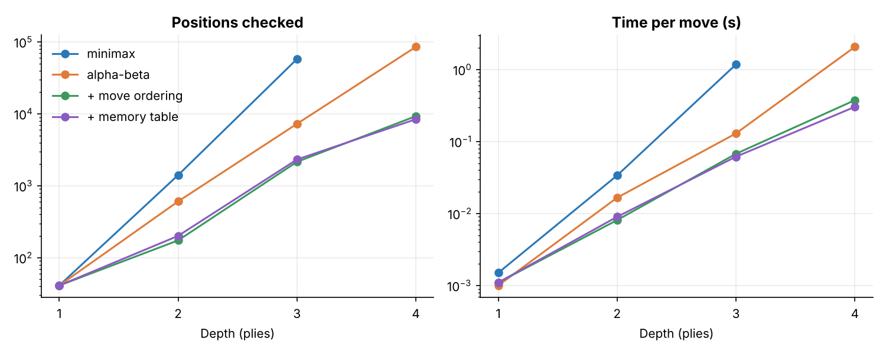
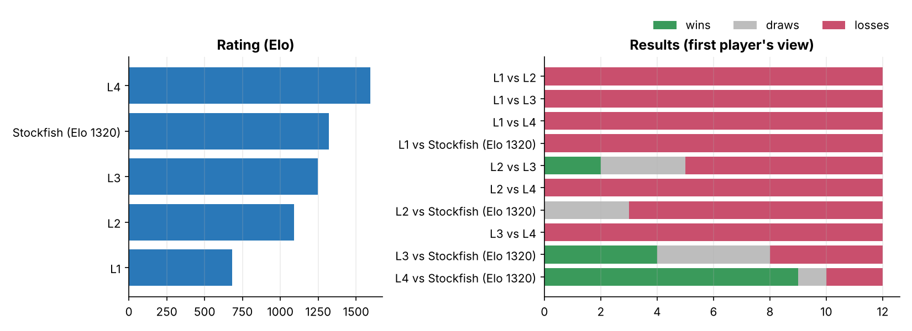
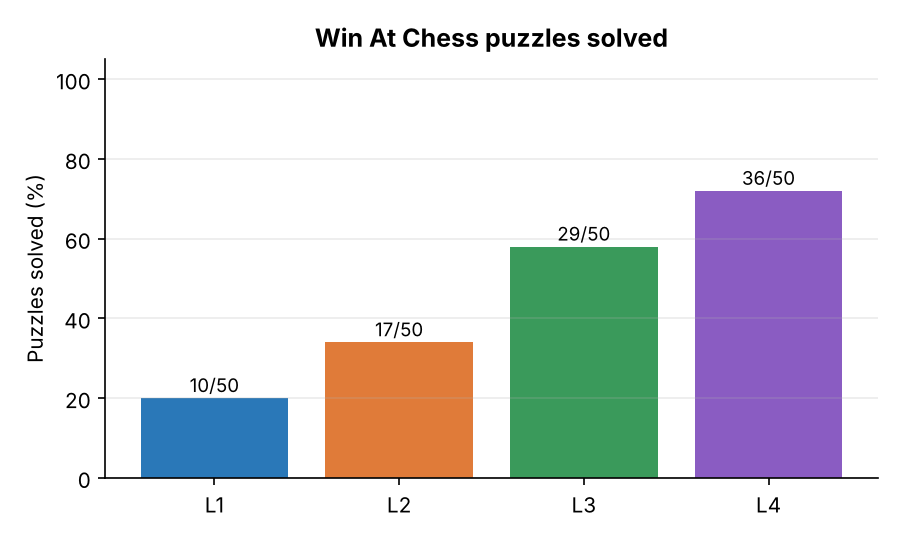

# Chess in the Hand of AI

A chess app where you play against the computer at **four AI levels** – Easy, Medium, Hard and Master.
Each level adds one classical AI technique to the level before it, and a benchmark suite measures how much each technique helps.

*Introduction to AI (IT3160E) · HUST · Group [__]*


---

## Contents
- [Quick start](#quick-start)
- [How the AI works](#how-the-ai-works)
- [Project structure](#project-structure)
- [How we test it](#how-we-test-it)
- [Results](#results)
- [Limits](#limits)
- [Credits](#credits)

---

## Quick start

Requires **Python 3.10+**.

```bash
git clone https://github.com/<your-account>/chess-in-the-hand-of-ai.git
cd chess-in-the-hand-of-ai
python -m venv .venv
source .venv/bin/activate          # Windows: .venv\Scripts\activate
pip install -r requirements.txt
```

**Play in the browser**

```bash
python -m app.server
# then open http://127.0.0.1:5000
```

Pick a level, your colour and the time per move, then click a piece and a target square.
The right panel shows what the AI did: its move, score, search depth, positions checked, time and the line it expects.

**Play in the terminal**

```bash
python play_cli.py --level 4 --color black --time 2
```

**Run the unit tests**

```bash
python -m pytest
```

**Run the benchmarks** (no screen needed)

```bash
python -m benchmark.run_all --quick                              # ~30–40 min
python -m benchmark.run_all                                      # full settings, several hours
python -m benchmark.run_all --quick --stockfish /path/to/stockfish   # add a weak Stockfish as reference
```

Every test can also be run on its own – see [How we test it](#how-we-test-it).

---

## How the AI works

In a normal chess position there are about 35 legal moves. Looking 6 plies (half-moves) ahead means
about 35⁶ ≈ 1.8 billion positions – far too many to check one by one. So the AI must choose which moves
are worth checking and judge a position without playing it to the end.

| Level | Name | Search | Depth | Evaluation |
|---|---|---|---|---|
| 1 · Easy | Greedy | Looks 1 ply ahead, takes the move that wins the most material. Ties broken at random. | 1 ply | material |
| 2 · Medium | Minimax | Full-width minimax: expects the opponent to play their best reply. | 3 plies (fixed) | material + piece-square tables |
| 3 · Hard | Alpha-beta | Skips branches that cannot change the result; checks good moves first (captures by MVV-LVA, killer moves, history heuristic); iterative deepening until the time runs out. | as deep as 2 s allows | material + piece-square tables |
| 4 · Master | Full engine | Level 3 + transposition table (memory of positions already seen) + quiescence search (keeps checking captures so it never stops in the middle of an exchange). | as deep as 2 s allows | full: tapered piece-square tables, pawn structure (doubled, isolated, passed), mobility, bishop pair, game phase |

**Input:** board position (FEN), legal moves (from `python-chess`), settings (level, time per move).
**Output:** the move, plus search numbers – score, depth, selective depth, positions checked, time, positions per second, expected line.

Scores are in centipawns (100 = one pawn) from the side to move. Mate scores are shown as "mate in N".

---

## Project structure

```
chess-in-the-hand-of-ai/
├── chessai/                 # the AI (no interface code)
│   ├── evaluation.py        # 3 score functions: material, pst, full            – Member 4
│   ├── search.py            # greedy, minimax, alpha-beta + ordering,           – Members 2, 3
│   │                        #   iterative deepening, time control,              – Member 1
│   │                        #   transposition table, quiescence                 – Member 3
│   └── engine.py            # the 4 levels and named variants (L3+full, …)
├── app/                     # web interface (Flask + plain JS)                  – Member 5
│   ├── server.py
│   └── static/  index.html · app.js · style.css
├── play_cli.py              # terminal version
├── benchmark/               # automatic tests, no screen                        – Members 1, 5
│   ├── correctness.py       # Test 1 · alpha-beta = minimax
│   ├── speed.py             # Test 2 · positions checked / time per depth
│   ├── evaluation_match.py  # Test 3 · same search, 3 score functions
│   ├── tournament.py        # Test 4 · AI vs AI round robin + Elo (+ Stockfish)
│   ├── puzzles.py           # Test 5 · 50 Win At Chess puzzles
│   ├── run_all.py           # runs all five
│   ├── common.py            # games, openings, Elo maths, CSV/PGN output
│   └── plotting.py
├── tests/                   # pytest unit tests
├── data/
│   ├── wac50.epd            # 50 Win At Chess puzzles (WAC.001–050)
│   └── openings.txt         # 24 opening lines for AI-vs-AI games
├── results/                 # CSV, JSON, PNG charts and PGN games produced by the benchmarks
└── docs/
```

### Who does what

| Member | Part | Files |
|---|---|---|
| Member 1 | Game engine (python-chess), time control, tests | `search.py` (iterative deepening, `SearchTimeout`), `benchmark/common.py`, `tests/` |
| Member 2 | Minimax, alpha-beta, move ordering | `search.py` (`minimax_search`, `AlphaBetaSearcher._negamax`, `_order_moves`) |
| Member 3 | Memory table and capture search | `search.py` (`_tt_store`, TT probe, `_qsearch`) |
| Member 4 | Evaluation function | `evaluation.py` |
| Member 5 | Interface and testing scripts | `app/`, `play_cli.py`, `benchmark/*.py` |

---

## How we test it

| Test | Command | What it measures |
|---|---|---|
| 1 · Correctness | `python -m benchmark.correctness --depth 3` | Alpha-beta (with and without move ordering) gives the **same score** as minimax on 50 positions at depths 1–3. Scores are compared, not moves, because two moves can share the best score. No transposition table or quiescence here, as they legitimately change scores. |
| 2 · Speed | `python -m benchmark.speed --positions 20 --depth 4` | Positions checked and time at depths 1–4 for minimax → alpha-beta → + move ordering → + memory table. |
| 3 · Evaluation | `python -m benchmark.evaluation_match --openings 24 --time 1` | Level 4 search with the three score functions playing each other. Same search, so differences come from the evaluation alone. |
| 4 · Strength | `python -m benchmark.tournament --openings 24 --time 2` | Round robin from 24 openings, both colours. Wins/draws/losses, Elo difference with a 95 % interval, and an overall rating. Add `--stockfish PATH --sf-elo 1320` for a weak Stockfish reference (1320 is Stockfish's lowest `UCI_Elo`). |
| 5 · Tactics | `python -m benchmark.puzzles --time 2` | Share of the 50 Win At Chess puzzles where the AI plays the book move. |

**Ablation:** to separate the effect of each Level 4 ingredient, run the tournament on variants:

```bash
python -m benchmark.tournament --engines L3,L3+full,L3+TT,L3+Q,L4 --tag ablation --time 1
```

Game rules for AI-vs-AI: a game is drawn after 200 plies, and adjudicated as a win when one side is ahead
by at least 10 pawns of material for 6 plies in a row (to save time; disable with `--no-adjudicate`).
All games are saved as PGN in `results/games/`.

---

## Results

These numbers come from the **quick** run (`python -m benchmark.run_all --quick`) on a 2-core cloud machine.
Re-run with the full settings for the final report; the CSV/JSON/PNG files in `results/` are overwritten.

### Test 1 · Correctness – PASS

Alpha-beta (with and without move ordering) gave **the same score as minimax in 150/150 checks**
(50 positions × depths 1, 2, 3). `results/correctness.csv`

### Test 2 · Speed – positions checked per move (average of 10 positions)

| Depth | Minimax | Alpha-beta | + move ordering | + memory table |
|---|---:|---:|---:|---:|
| 2 | 1 407 | 606 | 174 | 201 |
| 3 | 57 890 | 7 270 | 2 152 | 2 322 |
| 4 | – | 85 469 | 9 299 | 8 423 |

At depth 3 alpha-beta with move ordering checks **27× fewer positions** than minimax
(1.18 s → 0.07 s per move). The memory table mainly pays off at depth 4 and beyond.



### Test 3 · Evaluation – Level 4 search, three score functions (4 openings × 2 colours, 0.3 s/move)

| Score function | Points | Rating (material = 0) |
|---|---:|---:|
| full | 12 / 16 | +378 |
| material + piece-square tables | 11 / 16 | +346 |
| material only | 1 / 16 | 0 |

Piece-square tables bring the big jump; the extra terms of the full evaluation scored 3 wins, 2 draws, 3 losses
against PST alone – no measurable difference with so few games.

### Test 4 · Strength – round robin (6 openings × 2 colours, 0.3 s/move, + Stockfish `UCI_Elo` 1320)

| Engine | Points | Rating* |
|---|---:|---:|
| **L4 Master** | 45.5 / 48 | ≈ 1595 |
| Stockfish (UCI_Elo 1320) | 31 / 48 | 1320 (anchor) |
| L3 Hard | 26.5 / 48 | ≈ 1248 |
| L2 Medium | 17 / 48 | ≈ 1090 |
| L1 Easy | 0 / 48 | ≈ 681 |

Order **L4 > L3 > L2 > L1** as expected. Each higher level won every game against L1, and L4 won all 12 games against L3 and against L2.

\*Ratings are anchored on Stockfish's `UCI_Elo`, which is calibrated for longer time controls, and come from
12 games per pair, so treat them as a ranking with roughly ±150 Elo of uncertainty, not exact numbers.
Pairs with a 100 % score have no finite Elo difference (shown empty in `tournament_pairs.csv`).



### Test 5 · Tactics – 50 Win At Chess puzzles (1 s per puzzle for L3/L4)

| Level | Solved | Average depth |
|---|---:|---:|
| L1 Easy | 10 / 50 (20 %) | 1 |
| L2 Medium | 17 / 50 (34 %) | 3 |
| L3 Hard | 29 / 50 (58 %) | 4.4 |
| L4 Master | 36 / 50 (72 %) | 3.9 (+ quiescence) |

L4 reaches a slightly *lower* nominal depth than L3 in the same time, because the full evaluation and quiescence search
cost time, yet it solves more puzzles: quiescence lets it see the end of every capture sequence
(selective depth often 12–17 plies).



---

## Limits

- **Python is slow.** `python-chess` generates moves in pure Python, so the engine checks roughly
  10 000–50 000 positions per second. That limits Level 3 and 4 to about 4–6 plies in 2 seconds.
- **Horizon effect.** Quiet threats (not captures) that lie beyond the search depth can still be missed.
  Quiescence search fixes this only for captures.
- **Level 2 has a fixed depth**, so its time per move varies a lot between quiet and sharp positions.
- **Elo numbers have wide error bars** with a few dozen games per pair; they are good for ranking, not for exact ratings.
- **Repetitions** are scored as draws inside the search; the transposition table can occasionally mix up
  positions reached by different move orders (a known, accepted trade-off).

---

## Credits

- [python-chess](https://github.com/niklasf/python-chess) (GPL-3.0) – move generation, rules, PGN/EPD, piece images.
- Piece-square tables: Tomasz Michniewski, *Simplified Evaluation Function* ([Chess Programming Wiki](https://www.chessprogramming.org/Simplified_Evaluation_Function)).
- Puzzles: *Win At Chess* by Fred Reinfeld (1958), EPD version as distributed with the
  [Sunfish](https://github.com/thomasahle/sunfish) engine tests.
- Techniques: [Chess Programming Wiki](https://www.chessprogramming.org/) – alpha-beta, MVV-LVA, killer moves, history heuristic, transposition table, quiescence search.

Licensed under GPL-3.0 (see `LICENSE`), the same licence as python-chess.
